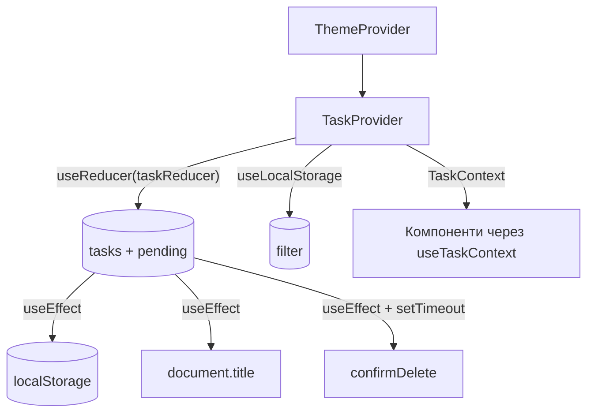

# Study Planner

Планувальник навчальних завдань на React 19 + TypeScript + Vite. Стилі — SCSS за методологією BEM.

- Лабораторна робота №8 — компоненти, JSX, props, `useState`, події, списки та умовний рендеринг (гілка `feature/react-fundamentals`).
- Лабораторна робота №9 — `useReducer`, Context API, `useEffect`, localStorage та власні hooks (гілка `feature/state-effects`).

## Можливості

- список завдань з назвою, описом, категорією, пріоритетом і станом виконання
- додавання та редагування завдання; назва обов'язкова
- позначення виконаним і повернення в стан «не виконано»
- Undoable Delete: завдання стає «Буде видалено», Toast показує 5-секундний прогрес і кнопку «Скасувати», після завершення таймера завдання видаляється остаточно
- «Очистити виконані» з тим самим undo-flow та кнопка «Скинути дані»
- Toast-повідомлення про створення, редагування, остаточне видалення, скасування та помилки
- фільтри «Всі», «Не виконані», «Виконані» з лічильниками; активний фільтр зберігається
- статистика: всього, виконано, не виконано та прогрес
- окремі повідомлення для порожнього списку та для порожнього результату фільтра
- пошук за назвою та сортування за пріоритетом
- завдання зберігаються в localStorage; пошкоджені дані замінюються початковим списком
- заголовок вкладки показує кількість невиконаних завдань: `Study Planner — 3 active tasks`
- світла й темна тема з окремим `ThemeContext`, яка зберігається між перезавантаженнями
- зміни завдань, фільтра й теми синхронізуються між відкритими вкладками

## Організація state



### Reducer

`src/reducers/taskReducer.ts` — чиста функція без HTTP, DOM, localStorage та UI-логіки. Дії типізовані як `TaskAction`:

| Дія              | Що робить                                              |
| ---------------- | ------------------------------------------------------ |
| `add`            | додає завдання на початок списку                       |
| `toggle`         | змінює `completed`                                     |
| `update`         | замінює назву, опис, категорію та пріоритет            |
| `requestDelete`  | позначає завдання як таке, що очікує видалення         |
| `confirmDelete`  | остаточно видаляє завдання після таймера               |
| `undoDelete`     | скасовує заплановане видалення                         |
| `clearCompleted` | ставить усі виконані завдання в чергу видалення з undo |
| `reset`          | повертає початкові дані                                |
| `sync`           | приймає завдання, змінені в іншій вкладці              |

Ключ, час початку й час завершення видалення обчислює провайдер і передає в payload, тож reducer залишається детермінованим. Підтримується кілька одночасних видалень.

### Context та hooks

- `TaskProvider` (`src/context/TaskProvider.tsx`) надає `tasks`, `filter`, `setFilter`, `addTask`, `updateTask`, `toggleTask`, `requestDelete`, `undoDelete`, `clearCompleted`, `resetTasks` і тости. Компоненти не знають про reducer і таймери.
- Дії стабільні завдяки `useCallback`, а value контексту створюється в `useMemo`.
- `useTaskContext()` кидає зрозумілу помилку, якщо його викликати поза `TaskProvider`.
- `useLocalStorage<T>()` читає значення з перевіркою типу, записує його в `useEffect` і слухає подію `storage`. Він зберігає фільтр і тему; tasks зберігає лише провайдер, тож друге джерело правди не з'являється.
- `useToasts()` керує списком повідомлень; `useTheme()` дає доступ до `ThemeContext`.

### Effects

- запис tasks у localStorage після кожної зміни;
- синхронізація `document.title` з кількістю невиконаних завдань;
- таймери Undoable Delete з `clearTimeout` у cleanup; колбек таймера оголошено через `useEffectEvent`, щоб він бачив актуальні tasks і не перезапускав таймери після кожної зміни списку;
- автоматичне закриття Toast;
- підписка на подію `storage` для синхронізації вкладок.

Відфільтрований список, статистика та лічильники обчислюються під час рендеру, а не в effects.

## Структура

```
src/
├── components/   кожен компонент у власній теці з .tsx та .scss
│   └── Toast/    Toast, UndoToast, ToastViewport
├── context/      taskContext.ts, TaskProvider.tsx, themeContext.ts, ThemeProvider.tsx
├── data/         initialTasks.ts
├── hooks/        useTaskContext, useLocalStorage, useToasts, useTheme
├── reducers/     taskReducer.ts
├── styles/       global.scss (змінні, reset, базові стилі)
├── types/        task.ts
├── utils/        tasks.ts, storage.ts
├── App.tsx
└── main.tsx
```

## Запуск

Потрібен Node.js 22.22 або новіший.

```sh
npm install
npm run dev
```

| Команда              | Опис                                |
| -------------------- | ----------------------------------- |
| `npm run dev`        | dev-сервер                          |
| `npm run build`      | перевірка типів і production-збірка |
| `npm run type-check` | лише перевірка типів                |
| `npm run lint`       | ESLint                              |
| `npm run format`     | Prettier                            |
| `npm run preview`    | перегляд зібраної версії            |
